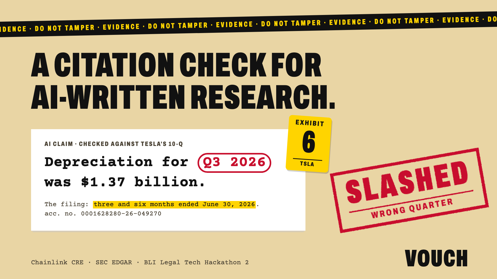

# Vouch



**A citation check for AI-written research.** Every claim an analyst, human
or AI, makes about a public company is checked against the company's SEC
filing, and the check is a **Chainlink CRE** workflow. A wrong claim costs its
author its stake. An AI trading agent can only trade on claims that held, and its
journal shows the receipts for every trade.

> An AI analyst (Qwen 2.5 7B) wrote about Tesla: *"Depreciation for Q3 2026 was $1.37 billion."*
> The 10-Q says that quarter ended in **June**. The check caught it, the AI lost
> its 25 USDG stake (test USDG), and a trading agent that cited the claim was **refused,
> on-chain**.

Where each part of that has run:

| | Where | Settled by |
|---|---|---|
| The AI wrote it; stake slashed; trade refused | Robinhood Chain testnet, 24 Sep ([slash](https://explorer.testnet.chain.robinhood.com/tx/0xbed0273dfe767314c80bdad33187044bfcda94f68b6853ef9c1e2b33a1912892), [refused trade](https://explorer.testnet.chain.robinhood.com/tx/0x885779d54f221e655c1c2242fef7361383d11eaaf123cd6aea2f7fbd5b9698d9)) | v1: one verifier key, before the CRE work |
| The same words, re-posted (their hash matches v1's), slashed; trade refused; journal | a local devnet (anvil), [`web/feed-local.json`](web/feed-local.json) | **the CRE workflow's own handler, in Chainlink's CRE SDK test runtime** ([`scripts/sdk_round.sh`](scripts/sdk_round.sh)) |

<!-- round:readme -->**On Robinhood Chain testnet with the CRE CLI simulation:** the round's market is deployed and its 50 claims were posted on 15 Oct ([the round](docs/bli/TESTNET_ROUND.md), market [0x3234bd…3E1a33](https://explorer.testnet.chain.robinhood.com/address/0x3234bd274FF76aB2eB3487eC91cD14cbAc3E1a33)). The verdicts wait on the CRE login; then one command settles them.<!-- /round:readme -->

## For judges: five minutes, nothing to install

1. **One claim:** [vouch-feed.vercel.app/?claim=6&view=claim](https://vouch-feed.vercel.app/?claim=6&view=claim).
   Exhibit 6: the AI's statement with the wrong words ringed, the filing's
   sentence marked, the findings, the verdict, and its chain of custody.
2. **The record of reliance:** [?record=TSLA](https://vouch-feed.vercel.app/?record=TSLA).
   The one page counsel keeps for a paper trade: exhibits relied on and refused,
   the chain of custody, how to re-check every line, what it does not prove.
   *Print or save as PDF* gives the page.
3. **Re-verify a trade:** [?view=journal](https://vouch-feed.vercel.app/?view=journal),
   then *Re-verify this trade*: every hash, verdict and refusal, and the
   agent's rules, recomputed in your browser.
4. **Check a claim yourself:** *Check a claim*, then "The AI's wrong quarter".
   The same check, against the company's 10-Q fetched live from SEC EDGAR.
5. **The news checker on real posts (RYO):** [?feed=feed-kol-real.json&view=journal](https://vouch-feed.vercel.app/?feed=feed-kol-real.json&view=journal).

[For lawyers: Reg AC, FINRA 2241](docs/bli/LEGAL.md) ·
[The Chainlink CRE workflow](cre/README.md) · [Architecture](docs/bli/ARCHITECTURE.md) ·
[Deck](docs/bli/deck.pdf) · [Video script](docs/bli/DEMO_SCRIPT.md) · [The testnet round](docs/bli/TESTNET_ROUND.md)

## Test it on your machine

macOS or Linux, with [Foundry](https://book.getfoundry.sh), Python 3.11+ and
[bun](https://bun.sh). About ten minutes; nothing touches a public chain.

| What | Command | Expect |
|---|---|---|
| Contracts | `forge test` | 57 passed |
| Agent, journal, rounds on a local EVM | `python3 -m venv .venv && .venv/bin/pip install "web3>=7,<8" pytest && .venv/bin/python -m pytest -q` | 76 passed, 1 skipped (a fork test that needs network) |
| The CRE workflow | `cd cre/vouch-verifier && bun install && bun run fixtures && bun test` | 24 pass (`fixtures` downloads five 10-Qs from SEC EDGAR; set `VOUCH_SEC_CONTACT_EMAIL` to your address) |
| A whole round, every verdict built by the workflow's own handler in Chainlink's SDK test runtime | `bash scripts/sdk_round.sh` | `N of N checks hold`; writes `web/feed-local.json` |
| The page, on that round | `python3 -m http.server -d web 8000`, then `http://localhost:8000/?feed=feed-local.json` | the claims, the case files, `?record=TSLA` |
| The record, from the command line | `PYTHONPATH=agent .venv/bin/python -m vouchrh.journal verify web/feed-local.json` | every check holds; edit one word of a claim and it fails |

---

## Why this matters

Research regulation assumes a person. Regulation AC has the *research
analyst*, defined as a "natural person", certify that the views "accurately
reflect the research analyst's personal views". FINRA Rule 2241(c)(1)(A)
requires a firm's procedures to ensure "purported facts in its research
reports are based on reliable information". FINRA says its rules are
"technology neutral" and that firms "are responsible for their
communications, regardless of whether they are generated by a human or AI".

A model cannot certify a belief. A firm *can* show that every fact the
model published was checked against the source, by a process nobody at the
firm controls, and that its trading agent acted only on what held. Vouch is
that record. [What it proves, and what it does not →](docs/bli/LEGAL.md)

## How it works

```
 analyst (AI or human) ── posts a claim: figure + verbatim sentence + SEC accession, with a USDG stake
            │  the exact words go on-chain in the Posted event; their keccak256 in storage
            ▼
 Chainlink CRE workflow (log trigger on Posted). On a DON every node runs it; in the
 CLI simulation one local node does:
     fetch the filing from SEC EDGAR → the deterministic check → {verdict, reason, keccak256(filing)}
            │  on a DON: nodes must agree and sign; in simulation: nothing is signed
            ▼
 Chainlink forwarder → BondedClaims.onReport  ── wrong: stake slashed to the readers' fund
            │                                      right: stake returned
            ▼
 AgentDesk ── a trading agent opens a paper position citing claims; any claim that failed reverts the trade
            ▼
 the journal ── each trade's cited claims, their verdicts, the agent's reasoning, hashed on-chain
```

1. **Stake.** An analyst bonds USDG and posts a claim: one figure, the
   sentence from the 10-Q that supports it, and the filing's accession number.
2. **Check, by Chainlink.** A CRE workflow fetches that filing from SEC EDGAR
   and runs the check: the quote must be a whole sentence of the filing, every
   figure exact, and the period, quarter, date and direction as filed. There
   is no verifier key: the market accepts a verdict only from the Chainlink
   forwarder. (In the simulation that forwarder is Chainlink's mock, which
   anyone can call; see [What is trusted](#what-is-trusted).)
3. **Pay.** A wrong claim loses its stake in the same transaction as the
   verdict. A right one keeps it.
4. **Gate.** `AgentDesk` will not let an agent trade on a claim that failed,
   or one still unchecked. The refusal is a reverted transaction anyone can
   look up.
5. **Journal.** Every paper trade records the cleared claims it cites, the
   verdict on each, and the hash of the agent's reasoning. Anyone can walk it
   back to the filing, in the browser or from the command line.

## The trading agent's reasoning trail

The agent reads every claim about a stock, as a reader follows several
analysts. It forms a thesis by fixed rules (did the figure rise or fall; is
rising good or bad for the company), then asks the desk to open a paper
position citing everything it read. The desk refuses any trade that cites a
claim that failed the check, and names the claim. The agent drops it, records
the refusal, re-forms its thesis on what is left, and tries again.

In the local round in `web/feed-local.json` (verdicts by the CRE workflow's
handler in the SDK test runtime) it read 50 claims about five stocks, was
refused 17 times, and made 2 trades, each on claims that held.
Run the same rules over AMD's claims in the published testnet round: on
everything it read, the agent would go **short**, because a fabricated
"expenses rose" story tips it; on what cleared the check, it goes **long**.
That difference is what the desk is for.

Each journal entry is the chain of reasons, in order:

```
claim (exact words, hash on-chain) → filing sentence (SEC EDGAR) → verdict (who wrote it, filing hash, tx)
   → signal per claim (the rule) → decision → trade (tx, entry id, reasoning hash stored with it)
```

- **In the browser:** *Re-verify* on any entry recomputes the record's
  hash, every claim's hash and verdict, the refusals, and re-runs the agent's
  rules (the same code, compiled for the page). On a public chain it reads
  the receipts back from the RPC.
- **For the file:** *Print the record of reliance* gives the one-page record
  (`?record=<ticker>`), and *Download it as text* writes the same as Markdown: every claim's exact words and hash, the filing, each verdict with its
  filing hash and transaction, the refusals, the reasoning record, how to check
  each line independently, and what the record does not prove.
- **From the command line:** `python -m vouchrh.journal verify feed.json --rpc <url>`
  also re-fetches every filing from EDGAR and re-runs the check.
  In the local round: 87 of 87 checks hold (KOL round: 85 of 85). Editing one
  word of a reasoning record, or of a claim, fails it (tested).

## For RYO-CHAN: the agent as a news checker

RYO's directions include a **News Checker** ("verify a story, connect it to
market evidence") and a **Multi-KOL** agent. Vouch's agent does the checking
those leave out. In KOL mode ([`agent/vouchrh/kol.py`](agent/vouchrh/kol.py))
it reads posts by market voices about the stock tokens on Robinhood Chain, by
fixed rules: which token, which figure, which period, and the voice's
sentiment, conviction and urgency. It writes each story with its figures as
the filing writes them, finds the 10-Q sentence the figure must come from, and
posts the story as a staked claim by that voice. A story that misstates the
figure, the quarter or the direction is slashed, and the desk refuses any trade
that leans on it. Loud, high-conviction voices whose story fails move nothing.

The 20 posts are a **fixture** ([`feed/kol/posts.json`](feed/kol/posts.json)):
written for this demo by fictional accounts, and labelled so in the feed and
on the page. 11 are true to the filing, 9 wrong on purpose; each gets the
verdict it was written for (tested). `bash scripts/sdk_round.sh --kol` settles
them with the CRE workflow's handler: 2 paper trades, 9 refusals, journal 85
of 85 ([`web/feed-kol.json`](web/feed-kol.json), `?feed=feed-kol.json`).

**Real posts.** [`agent/vouchrh/posts_fetch.py`](agent/vouchrh/posts_fetch.py)
took a snapshot of 130 real public posts naming the five companies with a dollar
figure, from Mastodon's public tag timelines, 15 Jul to 15 Sep 2026, no account
used ([`feed/kol/real/posts.json`](feed/kol/real/posts.json), each with its url
and sha256). [`agent/vouchrh/reader.py`](agent/vouchrh/reader.py) reads each
post with a language model behind any OpenAI-compatible endpoint
(`VOUCH_READER=model`), or the word lists by default; a model's exact messages
and reply are hashed into the record and replayed by Re-verify. The agent
stakes on a story itself, and only where a sentence of the 10-Q states the
figure: the check reads sentences, not tables. `bash scripts/sdk_round.sh
--kol-real` runs it on a local chain with the CRE workflow's handler:

| Reader | Posts the model read | Checkable figure | Staked | Verdicts | Feed |
|---|---|---|---|---|---|
| Claude Haiku 4.5 (through an OpenAI-compatible relay) | 99 of 130 (the rest carry no amount in millions or billions; the word lists read those) | 16 | 3 | 3 cleared | `?feed=feed-kol-real.json` |
| Word lists | none | 31 | 6 | 5 cleared, 1 slashed (Palantir "$1.5B in 3 months": the filing's $1.5 billion is six-month 2025 gross profit) | `?feed=feed-kol-real-rules.json` |

Handles are shortened on the page; each post's url is in the record. Live
posts from X are not read.

## Chainlink CRE

The verifier is a Chainlink Runtime Environment workflow. These files use
Chainlink:

| File | Chainlink |
|---|---|
| [`cre/vouch-verifier/workflow.ts`](cre/vouch-verifier/workflow.ts) | The workflow: EVM log trigger, HTTP capability (SEC EDGAR), identical consensus, `runtime.report`, `EVMClient.writeReport` |
| [`cre/vouch-verifier/workflow.test.ts`](cre/vouch-verifier/workflow.test.ts) | The handler in the CRE SDK's test runtime with its HTTP and EVM mocks |
| [`cre/project.yaml`](cre/project.yaml), [`cre/vouch-verifier/workflow.yaml`](cre/vouch-verifier/workflow.yaml), [`config.staging.json`](cre/vouch-verifier/config.staging.json) | CRE project, targeting Robinhood Chain testnet (`robinhood-testnet`) |
| [`src/BondedClaims.sol`](src/BondedClaims.sol) | The consumer: `IReceiver.onReport`, accepts verdicts only from the forwarder, from the configured workflow owner and name, optionally one pinned workflow id |
| [`test/LocalForwarder.sol`](test/LocalForwarder.sol), [`test/Reports.sol`](test/Reports.sol) | The forwarder's report layout, for Foundry tests |
| [`tests/test_cre_report.py`](tests/test_cre_report.py) | The SDK-built report settles a claim through Chainlink's own MockKeystoneForwarder (on a fork of Robinhood Chain testnet) |
| [`cre/vouch-verifier/sdk-round.ts`](cre/vouch-verifier/sdk-round.ts), [`scripts/sdk_round.sh`](scripts/sdk_round.sh) | The fallback round: every claim's report built by the workflow's handler in the CRE SDK test runtime |
| [`scripts/cre_round.sh`](scripts/cre_round.sh) | A testnet round settled by `cre workflow simulate --broadcast`, with a preflight and a dry run first. `--post` deployed and posted the round on 15 Oct; `--settle` (via `scripts/after_login.sh`) runs the workflow once the CRE login is done |

The check in the workflow is a line-for-line TypeScript port of the Python
check the market used, held to it by parity tests: **3,249 claims on five
real 10-Qs give the same verdict, reason and score, on Bun and on QuickJS,
the engine CRE runs** (re-run 14 Oct). Built with `cre workflow build` (CLI
v1.38.0). What has and has not been run is listed in [cre/README.md](cre/README.md).

## Proof it works

| | |
|---|---|
| Contracts | 57 Foundry tests: the readers' fund payout, forwarder-only settlement, forged workflow owner, name or id refused, verdict bound to the posted words, unchecked claims refused by the desk, no gain from challenging your own claim, money conserved through fuzzed disputes, the desk's refusals and citations, claims capped to fit CRE's 5 KB log limit, default clears not counted as checked. Slither: only the three challenge-window timestamp comparisons. |
| Agent and journal | 76 pytest tests (plus 1 on a fork of Robinhood Chain testnet) on a real EVM (anvil) and real SEC filings: journal re-verification and tamper detection, the KOL mode on fixtures and on real posts, the model reader's recorded replies, the SDK-runtime round, `cre_round.sh`'s preflight and failure handling |
| CRE workflow | 24 Bun tests (SDK runtime incl. malformed and mismatched claims, the same evidence whatever SEC's CDN adds, the production config's headers; Python parity; policy parity); QuickJS parity script; WASM build. On a fresh clone run `bun run fixtures` first, or the tests that need the filings skip |
| The check | Catches a changed figure in a quote that is 99.3% identical to the filing; a real AI's "Q3" for a June quarter; a six-month figure called a quarter; a reversed direction. No wrong calls over 1,444 scripted claims ([engineering notes](docs/ENGINEERING.md)) |
| Live | v1 contracts verified on Robinhood Chain testnet ([market](https://explorer.testnet.chain.robinhood.com/address/0x285AcbD8919fdAd7fa39753347656711eC51d426), [desk](https://explorer.testnet.chain.robinhood.com/address/0x6170c08ACF845C48032c9fAc118E62101cf29745)), settled by one verifier key; the hosted check at `POST https://vouch-feed.vercel.app/api/verify`. The CRE-settled market is deployed with its 50 claims posted ([the round](docs/bli/TESTNET_ROUND.md)). |

## What is trusted

- **Simulation** writes verdicts through Chainlink's mock forwarder, which
  checks no signatures and lets the caller choose the workflow metadata, so
  **anyone can settle a claim on a simulation market**. One local node runs
  the workflow and the operator's wallet sends the transaction. That market
  proves the path, not the security.
- **Production** points the market at Chainlink's `KeystoneForwarder`, which
  delivers only reports the DON signed, from the configured workflow owner and
  name. The deployer can pin one compiled workflow id, once; after that nobody
  can change who settles.
- **The filing** is whatever SEC EDGAR serves. The keccak256 on-chain is of
  the document without the one script tag SEC's CDN appends (its path changes
  over time, so raw bytes never hash the same twice); anyone can download it,
  drop that tag, and redo the hash and the check.
- **Production is not ready yet.** A DON's HTTP gateway refuses a User-Agent
  header, and SEC refuses requests without one (403); the gateway's default
  response cap (26.4 KB) is below a gzipped 10-Q (94-171 KB). Both need an
  answer before a live deployment ([cre/README.md](cre/README.md#production)).
- **Until a workflow id is pinned**, the workflow owner could replace the
  workflow's code under the same name; pinning (once, by the deployer) ends that.
- **No verdict, no trade.** If the network never answers, an unchallenged claim
  clears by default after its window, marked unchecked, and the desk refuses to
  let an agent cite it. Malformed words, or words naming another stock or filing
  than the one posted under, are slashed by the workflow without a fetch.
- **Where a slashed stake goes:** to the readers' fund, whose payees and shares
  are fixed in the constructor before any claim exists. Each payee withdraws its
  own share with `claimReaderShare()` (pull, rounded down, reentrancy-locked). On
  a test market the deployer stands in for the fund, and the feed says so; in
  production it would be a restitution or investor-protection account named at
  deploy. Choosing that account is a legal question, not a code one.
- **The check has limits it states:** it cannot tell a borrowing limit from a
  balance, or an inflow from an outflow described in words.

## Run it

```bash
forge test                                                   # contracts
python3 -m venv .venv && .venv/bin/pip install "web3>=7,<8" pytest
PYTHONPATH=agent:tests .venv/bin/python -m pytest tests      # agent, journal, a round on anvil
cd cre/vouch-verifier && bun install && bun run fixtures && bun test && cd ../..   # the CRE workflow
cre workflow build ./cre/vouch-verifier                      # WASM (CRE CLI)
bash scripts/sdk_round.sh                                    # the fallback round -> web/feed-local.json
bash scripts/sdk_round.sh --kol                              # KOL mode -> web/feed-kol.json

anvil &                                                      # a quick local round, settled by the Python check
PYTHONPATH=agent .venv/bin/python -m vouchrh.market --key 0xac0974bec39a17e36ba4a6b4d238ff944bacb478cbed5efcae784d7bf4f2ff80 --out /tmp/round.json
PYTHONPATH=agent .venv/bin/python -m vouchrh.journal verify /tmp/round.json --rpc http://127.0.0.1:8545
```

On Robinhood Chain testnet, settled by Chainlink CRE: `bash scripts/cre_round.sh --preflight`,
then `bash scripts/cre_round.sh` (needs `cre login` and a funded testnet wallet), or in two halves:
`--post` now and `--settle cre/runs/<run>` after the login. `bash scripts/after_login.sh` settles the
posted round and refreshes the docs, images and deck; `bash scripts/deploy_web.sh` checks the page
and `--go` publishes it. Images: `bash scripts/build_assets.sh`; deck: `bash scripts/build_deck.sh`.
The hosted check and the MCP tool are described in [docs/ENGINEERING.md](docs/ENGINEERING.md).

## Prior work

Built for Arbitrum Open House Singapore (from 24 September 2026), from an
earlier Vouch on Casper (June 2026). New for BLI Legal Tech Hackathon 2:
the check as a Chainlink CRE workflow and a contract that takes verdicts only
from Chainlink's forwarder (instead of a verifier key), the trading journal and the
record of reliance, the news checker on real posts, and the legal framing. [What changed, exactly →](docs/bli/WHATS_NEW.md)

## Licence

MIT.
